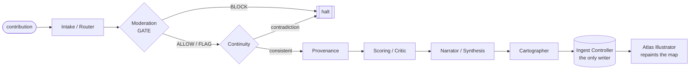
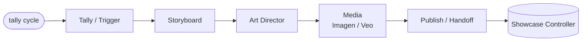

# World Engine — a safe, collaborative world that humans and agents co-author

> *An exquisite corpse that cannot collapse into chaos or harm — because the agents hold the
> coherence and safety the players can't see.*

**World Engine** is a multi-agent system for **collaborative storytelling**. A crowd of humans
submit fragments of a shared fictional world — characters, locations, factions, plot beats, lore —
and a graph of autonomous agents acts as the **referee and editor**: it moderates, checks
continuity against canon, traces provenance, scores each contribution, and weaves the accepted
ones into a persistent, ever-growing **canon**. Accepted geography literally redraws a living,
candlelit map. The most-loved storyline trees are turned into shareable media.

Built for the **Kaggle 5-Day AI Agents Intensive** capstone.
Stack: **ADK 2.0 graph-workflow API**, **agents-cli**, **Gemini** (image via **Imagen**, video via
**Veo**), a **FastAPI** REST layer, and a **React + Vite** front end, deployable to **Google Cloud
Run / Agent Runtime**.

---

## The problem, and why agents

Video games hand you a world someone else authored. World Engine is the opposite: **anyone can let
their imagination run wild — within clear perimeters of safety and compliance.** But you cannot let
strangers *collectively* author a shared world without moderation, continuity, provenance, and
safety running at machine speed. A human editorial team can't scale to it; an unguarded LLM can't
be trusted with it.

That is exactly the gap agents fill. The agents are **not** a feature bolted onto a storytelling
app — **they are the infrastructure of trust that makes open, safe co-creation possible at all.**
The AI is the **referee, not the author.**

> **Research question:** *Can a crowd and a set of autonomous agents co-author a coherent, safe
> fictional world under a time-boxed creative constraint — with the AI as referee, not author?*

**Seasons / themed drops.** A world is a limited-time themed drop ("Medieval Wizards"). The theme
kills the blank-canvas problem, concentrates the crowd into a shared event, holds art style and
moderation profile coherent, and gives "done" a meaning: when the drop closes, the world is
immortalized as a season-finale showcase anthology and the next theme opens.

---

## Architecture

The system is **two independent ADK graph workflows**, each wrapped in its own `App` so the local
playground, the eval harness, and the Cloud runtime can all discover and run them. Every `App`
carries the shared **`SecurityPlugin`** guardrail layer.

### 1. Ingest pipeline (`app` entrypoint)

Edges are **routed**, not just sequential: Moderation only routes `ALLOW`/`FLAG` onward (a `BLOCK`
halts the pipeline), and Continuity only routes `consistent` contributions onward.



1. **Intake / Router** — classifies the contribution type and normalizes free text into a typed `Contribution`.
2. **Moderation (GATE)** — deterministic + LLM safety checks; blocks disallowed content, prompt injection, and hidden payloads (acrostics, zero-width chars, base64/hex). Halts the pipeline on `BLOCK`.
3. **Continuity** — checks the contribution against the canon store for contradictions; halts inconsistent contributions.
4. **Provenance** — detects references (what existing canon this builds on) and proposes soft reference links.
5. **Scoring / Critic** — scores creativity / consistency / build-on and proposes a points delta for the simulated ledger economy.
6. **Narrator / Synthesis** — drafts the "what changed in the world" canon entry and **re-moderates its own generated summary** before proposing the write.
7. **Cartographer** — for spatial contributions, proposes a `region`, an `{x, y}` map position, and `near` links. **Users never place pins; the world self-assembles from lore.**
8. **Ingest Controller** *(deterministic, non-LLM)* — the single component that validates every proposal, clamps values, and persists to the store.
9. **Atlas Illustrator** — paints a painterly map tile for the new place and composites it into the world's master map canvas.

### 2. Showcase subgraph (`showcase` entrypoint)

A **separate** workflow, asynchronous and threshold-triggered, so it adds **no latency or cost** to
normal contributions. It fires when a storyline tree crosses the trigger in `policy.yaml`
(e.g. `min_votes: 10`, `min_composite_score: 70`).



- **Tally / Trigger** — assembles qualifying trees, ranks them (`votes` 0.6 + `score` 0.4), and emits `ShowcaseJob`s. The single top tree per cycle becomes a **Veo reel**; every other qualifier becomes a cheap **comic** (deliberate cost control).
- **Storyboard** — compresses a tree's canon into a title, logline, and ordered panels/scenes, each with a visual description and caption.
- **Art Director** — rewrites each panel/scene into a cinematic, style-consistent generation prompt.
- **Media** — generates each panel via Imagen (comic) or each scene via Veo (reel, 9:16, ≤8s/clip). Every asset is cached; identical content is never regenerated.
- **Publish / Handoff** — builds the caption + Instagram container payload, saves the asset to a (mock) GCS bucket, then **stops at the review gate** (`published_mock`) — it never auto-publishes.

---

## The core invariant: Proposal → Controller

**LLM nodes never perform side effects.** Each LLM node validates its output against a Pydantic
schema and writes a *proposal* into workflow state (`scoring_proposal`, `narrator_proposal`,
`cartographer_proposal`, `tally_proposal`, …). A **single deterministic, non-LLM controller** at the
end of each workflow (`app/core/controller.py`) is the *only* code that mutates the store: it
validates each proposal, **clamps** values (scores → 0–100, map coordinates → map bounds), and
confines GCS writes to the job's prefix.

This is the project's strongest design property: it gives a probabilistic system a small,
auditable, deterministic trust boundary. The agents can be creative; they cannot corrupt the world.

---

## Security model

`app/core/security.py` defines `SecurityPlugin` (an ADK `BasePlugin`) — a reusable guardrail layer
attached to every `App`:

| Hook | What it does |
| --- | --- |
| `before_model` | Unicode-normalize, strip zero-width chars, redact PII, run a deterministic + Flash-Lite prompt-injection screen, and **spotlight-wrap** untrusted text in `<user_contribution>` / `<canon_entry>` tags. |
| `after_model` | Enforce the output schema; block HTML/JS, ``, and non-allowlisted URLs. |
| `before_tool` | Enforce a per-agent **tool allowlist** (`AGENT_TOOL_ALLOWLIST`), strip dangerous tools from content-reading agents, confine GCS access to the job prefix, and require confirmation for irreversible actions. |
| `after_tool` | Re-screen tool results as untrusted input. |

**Trust boundary:** user contributions **and canon read back from the store** are *both* treated as
untrusted — because canon originated from users, it is a **second-order (indirect) injection
vector**. The Narrator even re-moderates its own generated summary before proposing a canon write.
Red-team cases live under `world-engine/tests/` and the eval suite.

> Coverage: every runner — including those built by the custom REST endpoints — is constructed
> from the `App` via `app/core/runner_factory.py`, so the plugin's guardrails apply on all paths.
> The in-graph Moderation gate and the deterministic controller run as additional, always-on layers
> inside the workflow itself.

---

## MCP Server — the world as a platform

`world-engine/app/mcp_server.py` exposes the living world over the **Model Context Protocol**, so
any MCP client (Claude Desktop, the MCP Inspector, an external author agent) can read the **living
manuscript** without being part of the graph. Five read-only tools span three layers:

- **World / season** — `get_world_state()` (opening line, status, contribution window)
- **World bible** — `get_codex(kind?)` (characters, locations, factions, …)
- **The manuscript** — `get_story(tree_id?)` (storyline trees → ordered chapters; the draft of the book)
- **Grounding** — `get_lore_context(query)` and `check_continuity(statement)`

It is built on the same `CanonStore` interface, and it is **read-only by construction**: there is
no write tool, because the only path that can mutate canon is the deterministic controller. The
Proposal→Controller trust boundary is thus enforced at the protocol surface too — an external client
can read the whole world but can never corrupt it or bypass moderation. The same read path is what a
future season-finale **book compiler** will consume.

```bash
cd world-engine
uv run python -m app.mcp_server     # serve over stdio
uv run mcp dev app/mcp_server.py    # inspect the tools interactively
```

---

## The Living Atlas

The world is not a list — it's a **map that draws itself**. As lore is accepted, the **Cartographer**
places it and the **Atlas Illustrator** paints it, producing a candlelit, fog-of-war world map in
the React UI with a hover codex. Players explore what the crowd has collectively imagined; regions
they haven't discovered stay shrouded.

---

## The Chronicle — the world narrates itself

Beyond *browsing* the canon, the world **tells you its story so far**. `GET /world/chronicle` runs a
**read-only synthesis** over the active world's storyline trees and returns a short, spoken-aloud
*"what we know so far"* recap — in the voice of a storyteller whose **form shifts with the world's
era**: a firelit **shaman** for a primal world, a wandering **bard** for medieval fantasy, a
present-day **influencer**, a **story-bot** for sci-fi. The persona is chosen by a cheap keyword
match on the world's `theme` (no extra model call), the prose is generated **once and cached**, and a
**Gemini TTS** voice-over (a per-persona prebuilt voice) is synthesized once and attached as
`audio_url` — so the UI's "Hear the Bard" button plays it instantly. Canon read back for the
synthesis is spotlight-wrapped as untrusted, exactly like the ingest Narrator. Personas and voices
live under `chronicle:` in `policy.yaml`. It's the same "tie the separate threads together" idea the
Narrator does internally — now offered to the reader (or an external agent) as the world's own voice.

---

## Agent roster

| Agent | Workflow | Role | Side effects? |
| --- | --- | --- | --- |
| Intake / Router | ingest | Classify + normalize into a typed `Contribution` | No (proposal only) |
| Moderation | ingest | Safety GATE; halts on `BLOCK` | No |
| Continuity | ingest | Detect canon contradictions | No |
| Provenance | ingest | Propose soft reference links | No |
| Scoring | ingest | Score creativity/consistency/build-on | No |
| Narrator | ingest | Draft + self-moderate the canon entry | No |
| Cartographer | ingest | Propose region + `{x,y}` + `near` links | No |
| **Ingest Controller** | ingest | **Validate, clamp, and persist all proposals** | **Yes (only writer)** |
| Atlas Illustrator | ingest | Paint + composite map tiles | Yes (assets, via controller path) |
| Tally / Trigger | showcase | Rank trees, emit `ShowcaseJob`s | No |
| Storyboard | showcase | Canon → panels/scenes | No |
| Art Director | showcase | Cinematic, style-consistent prompts | No |
| Media | showcase | Imagen / Veo generation + caching | No |
| Publish / Handoff | showcase | Build payload, stop at review gate | No |
| **Showcase Controller** | showcase | **Persist jobs/assets deterministically** | **Yes (only writer)** |

---

## How this maps to the course key concepts

| Key concept | Where it lives |
| --- | --- |
| **Agent / multi-agent system (ADK)** | Two ADK 2.0 graph workflows, 15 specialized agents, routed edges, the Proposal→Controller pattern (`world-engine/app/`). |
| **MCP Server** | `world-engine/app/mcp_server.py` — a read-only Canon MCP server (`get_world_state`, `get_codex`, `get_story`, `get_lore_context`, `check_continuity`) that exposes the living world to any MCP client, with no write path. |
| **Security features** | `SecurityPlugin` (injection screening, PII redaction, spotlighting, tool allowlists, second-order injection defense) + red-team tests. |
| **Agent skills (Agents CLI)** | `agents-cli` drives scaffold, playground, eval, and deploy — see commands below. |
| **Deployability** | `world-engine/Dockerfile` + Terraform under `world-engine/deployment/` for Cloud Run / Agent Runtime; SQLite locally, Firestore in the cloud. |
| **Antigravity** | The system was built with Antigravity (Gemini) as the coding agent. |

---

## Repository layout

```
.
├── README.md            # you are here
├── CONTEXT.md           # authoritative project spec — read before changing pipeline behavior
├── world-engine/        # Python backend: ADK graph agents + FastAPI REST layer
│   ├── app/agents/      # one module per agent
│   ├── app/core/        # store, controller, security, types, config
│   ├── app/agent.py     # ingest workflow + App  (entrypoint: app)
│   ├── showcase/agent.py# showcase workflow + App (entrypoint: showcase)
│   ├── policy.yaml      # single source of runtime config (models, thresholds, providers)
│   ├── deployment/      # Dockerfile + Terraform
│   └── tests/           # unit + integration + eval (incl. red-team security cases)
└── world-engine-ui/     # React 18 + Vite front end (auth, map, codex, showcase, voting)
```

`policy.yaml` is the single source of runtime config — flip `active_profile`
(`strict`/`default`/`permissive`) to change moderation strictness from one place, and swap media
providers without touching code.

---

## Setup & run

### Backend (`cd world-engine`)

```bash
uv sync                                   # install dependencies
uv run agents-cli playground              # local web UI for the agents
uv run pytest                             # full test suite (unit + integration)
uv run ruff check . && uv run ruff format .
```

Run the pipelines directly via the Agents CLI:

```bash
# Ingest a contribution through the full pipeline
uv run agents-cli run "Plot: Alistair lights the tavern fireplace with a spark of fire magic."

# Run the asynchronous showcase tally subgraph
uv run agents-cli run --app-name showcase "Run showcase tally"
```

The repo ships with a populated `world.db` SQLite file, so the playground and REST API have canon,
votes, and ledger scores to work with out of the box. Unit tests mock the LLM and run offline;
integration tests and any real generation path need Google Cloud credentials / a Gemini API key.

### Serve the REST API

```bash
cd world-engine
uv run uvicorn app.fast_api_app:app --reload   # http://localhost:8000
```

Front-end endpoints include `GET /world`, `GET /world/map`, `GET /world/chronicle`,
`GET /codex/{kind}`, `GET /canon/storylines`, `GET /canon/storylines/{treeId}`, `GET /canon/{id}`,
`GET /scenes/{id}`, `POST /discover`, `POST /vote`, `GET /showcase`, and `POST /contribute`
(runs the ingest pipeline synchronously).

### Front end (`cd world-engine-ui`)

```bash
npm install
npm run dev        # http://localhost:5173 — works immediately in demo mode (mock data)
```

It runs out of the box against mock data; point it at the backend and a Firebase project via
`.env` (`VITE_API_BASE_URL`, Firebase keys) to use real auth + data.

---

## Deployment

Participants are not required to deploy for judging, but this build is deployment-ready:

```bash
cd world-engine
uv run agents-cli deploy        # builds the container and provisions via Terraform (requires approval)
```

- `Dockerfile` containerizes the FastAPI + ADK app.
- `deployment/terraform/single-project/` provisions APIs, IAM, the Cloud Run service, storage, and telemetry.
- On Cloud Run (`K_SERVICE` set) or with `USE_FIRESTORE=True`, persistence transparently switches from SQLite to **Firestore** behind the `CanonStore` interface — no code changes.

A model 404 is almost always a `GOOGLE_CLOUD_LOCATION` issue (try `global`), not the model name.

---

## Responsible AI & scope

- The economy is **points-only and simulated** — no cryptocurrency, tokens, wallets, or real payments.
- Generated media keeps its **SynthID** watermark; it is never removed or obscured.
- Publishing **stops at a review gate** (`published_mock`) — nothing is auto-posted to any live platform.
- **No secrets in code:** all keys come from Secret Manager / environment, server-side only.
```
