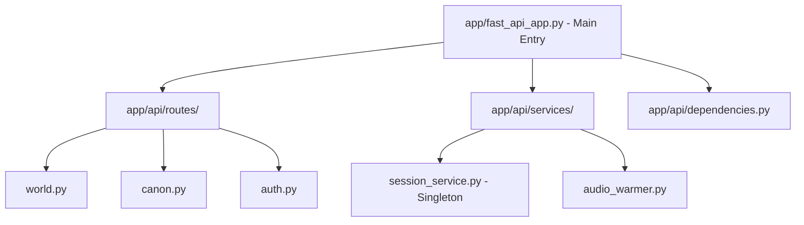

# Refactoring Proposal: Restructuring the REST Layer (`fast_api_app.py`)

This report evaluates the proposal to split up the 1,672-line `fast_api_app.py`, eliminate performance/readability bottlenecks like inline imports, and refactor the per-request `InMemorySessionService` lifecycle.

---

## 1. Known Issues in the Current REST Layer

### A. Size & Cognitive Load
With over 1,600 lines, `fast_api_app.py` mixes multiple distinct responsibilities:
1. **Application Lifecycle & Bootstrapping:** Startup/shutdown hooks, telemetry setup, background thread loops (showcase running & scene audio warming).
2. **Route Definitions:** Endpoints for player actions, map retrieval, story submissions, and voting.
3. **Helper & Utility Logic:** Audio attachment helpers, URL sanitization, Firebase token verification.
4. **Mock Data Definitions:** Inlined mock storylines, nodes, and profiles for offline development.

### B. Inline Imports Clutter
Inline imports (e.g., inside route handlers) are currently used to bypass circular dependency chains. While they prevent import loops, they:
* Scatter dependency declarations across the codebase.
* Create a performance overhead on request pathways.
* Make static analysis and unit testing more difficult by hiding actual dependencies.

### C. Per-Request `InMemorySessionService`
Instantiating `InMemorySessionService` inside request handlers is inefficient. It results in:
* Frequent allocations and garbage collection overhead.
* Loss of transient in-memory state between requests (if any state needs to persist across actions in memory).

---

## 2. Proposed Target Architecture

We should decompose `fast_api_app.py` into a modular directory structure under `app/api/`:



### A. Modular Structure
* **`app/fast_api_app.py`**: A thin entrypoint that only configures the `FastAPI` instance, mounts static files, registers middlewares, and includes API routers.
* **`app/api/routes/`**: Contains sub-modules grouping related endpoints:
  * `world.py`: World state, map, and chronicle endpoints.
  * `canon.py`: Storylines, chapters, scenes, contributions, and votes.
  * `auth.py`: Firebase token and authentication routes.
* **`app/api/dependencies.py`**: Defines common FastAPI dependencies (`get_db`, `get_current_user`, `get_session_service`).
* **`app/api/services/`**: Holds long-lived application logic:
  * `audio_warmer.py`: The TTS background pre-warming loop.
  * `showcase_runner.py`: The background showcase tally thread.

### B. Singleton Services & FastAPI Dependency Injection
Instead of instantiating `InMemorySessionService` inside routes, initialize a single instance at application startup and inject it via FastAPI's `Depends`:

```python
# app/api/dependencies.py
from fastapi import Request
from google.adk.sessions import InMemorySessionService

def get_session_service(request: Request) -> InMemorySessionService:
    # Retrieve the singleton instance stored in app.state
    return request.app.state.session_service
```

### C. Solving Circular Dependencies
Circular dependencies can be eliminated by:
1. **Isolating imports:** Making sure agent modules (`app/agents/`) never import routes or the `FastAPI` app object directly.
2. **Dependency Injection:** Passing the `store` or `session_service` references into functions rather than importing them globally.

---

## 3. Impact Assessment & Implementation Plan

| Action | Complexity | Risk | Benefit |
| :--- | :--- | :--- | :--- |
| **Move to Singleton Session Service** | Low | Low | Removes garbage collection churn; enforces consistent state. |
| **Extract Routes into Modules** | Medium | Medium | Dramatically increases readability; facilitates group work on endpoints. |
| **Remove Inline Imports** | Medium | Low | Clean, top-level import structures; improves request-time efficiency. |

### Suggested Phase-in Plan
1. **Phase 1 (Lifecycles):** Refactor the background threads (showcase and TTS warmer) out of `fast_api_app.py` and into service modules.
2. **Phase 2 (Singletons):** Store the `InMemorySessionService` in `app.state` at startup and define a FastAPI dependency to inject it.
3. **Phase 3 (Routing):** Step-by-step extract the `/world/*` and `/canon/*` routers into separate route files.

---

## 4. Risks & Mitigations

### A. Circular Dependency Deadlocks
* **Risk:** The python backend uses complex relationships where routers load agents, agents load helper functions, and helper functions check configs. Unraveling inline imports can easily trigger runtime `ImportError` or `AttributeError` circles.
* **Mitigation:** Move route files into a subdirectory (`app/api/routes/`) that sits entirely below the core app logic in the dependency hierarchy. Ensure that modules under `app/agents/` and `app/core/` never import anything from `app/api/`.

### B. Shared State Pollution
* **Risk:** Moving `InMemorySessionService` to a singleton means all incoming HTTP requests share the exact same service instance. If the service maintains request-specific state (like cached user tokens or inline transactions), requests could bleed into one another.
* **Mitigation:** Verify that `InMemorySessionService` is purely a thread-safe coordinator. Ensure any request-specific variables (like active credentials) are stored on FastAPI request/dependency contexts and passed explicitly as parameters rather than saved to session properties.

### C. Test Mocking Regressions
* **Risk:** Existing unit and integration tests (such as `test_server_e2e.py`) spin up a test FastAPI client and mock database methods. Splitting the endpoints across multiple files can break existing mock setups if tests try to patch methods at the wrong path or module namespace.
* **Mitigation:** Run the unit/integration tests (`pytest`) continuously during the routing split to verify that all mocks remain functional and patch targets are updated to match the new route file namespaces.

